# LAB-01 — Two-AZ Custom Enterprise Network Foundation

## Overview

This lab builds a custom AWS VPC across two Availability Zones with separate public and private subnets.

**Region:** Asia Pacific (Mumbai) — `ap-south-1`

## Network Design

| Component | CIDR / Configuration |
|---|---|
| VPC | `10.50.0.0/16` |
| AZ-A Public Subnet | `10.50.1.0/24` |
| AZ-A Private Subnet | `10.50.11.0/24` |
| AZ-B Public Subnet | `10.50.2.0/24` |
| AZ-B Private Subnet | `10.50.12.0/24` |
| Internet Gateway | 1 |
| Public Route Table | `Public-Lab1` |
| Private Route Table | `private-Lab1` |
| Public EC2 | 2 |
| Private EC2 | 2 |

## Objectives

- Create a custom VPC using `10.50.0.0/16`.
- Create four subnets across two Availability Zones.
- Separate public and private network tiers.
- Attach an Internet Gateway.
- Create dedicated public and private route tables.
- Explicitly associate the correct subnets with the correct route tables.
- Launch EC2 instances in public and private subnets.
- Configure Security Groups and Network ACLs.
- Validate public Internet connectivity.
- Validate private subnet isolation.
- Perform and restore the required route-table failure test.

---

## 1. VPC Creation

```text
Name: Lab-1
IPv4 CIDR: 10.50.0.0/16
```

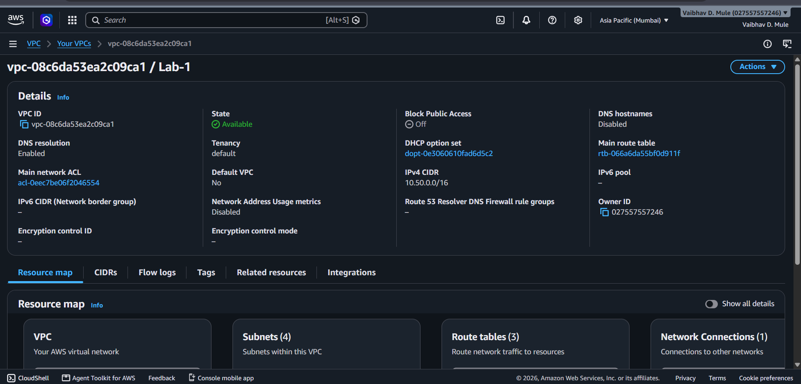

---

## 2. Subnets

### AZ-A — ap-south-1a

```text
Public-Sub-1A-Lab1   10.50.1.0/24
Private-Sub-2A-Lab1  10.50.11.0/24
```

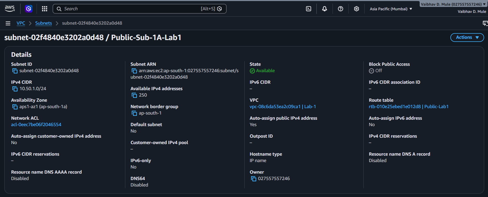

### AZ-B — ap-south-1b

```text
Public-Sub-1B-Lab1   10.50.2.0/24
Private-Sub-2B-Lab1  10.50.12.0/24
```

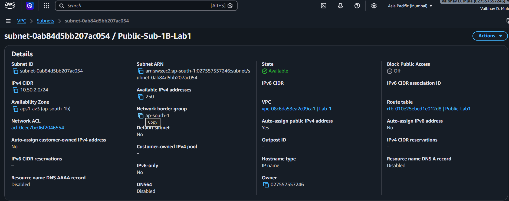

Public subnets:

```text
Auto-assign public IPv4 address: Yes
```

---

## 3. Internet Gateway

```text
Internet Gateway: IGW-Lab1
VPC: Lab-1
State: Attached
```

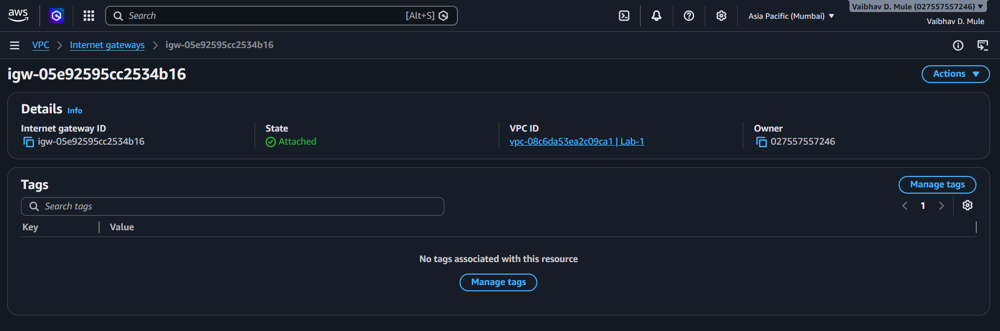

---

## 4. Public Route Table

```text
Route Table: Public-Lab1
```

Routes:

```text
10.50.0.0/16 → local
0.0.0.0/0    → Internet Gateway
```

Associated with:

```text
Public-Sub-1A-Lab1
Public-Sub-1B-Lab1
```

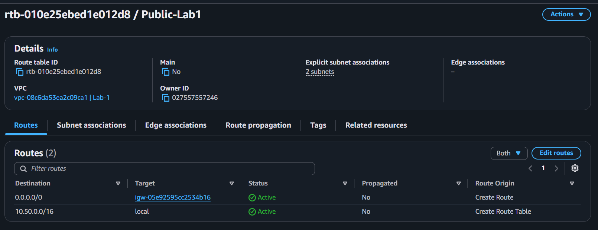

A subnet becomes public when its associated route table has a route to an Internet Gateway. An IPv4 EC2 instance also needs a public IPv4 address for direct Internet communication.

---

## 5. Private Route Table

```text
Route Table: private-Lab1
```

At this stage:

```text
10.50.0.0/16 → local
```

Associated with:

```text
Private-Sub-2A-Lab1
Private-Sub-2B-Lab1
```

Do not add an Internet Gateway route to the private route table for this lab.

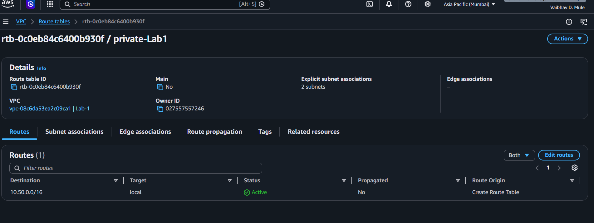

---

## 6. Network ACL

### Inbound

```text
Rule 100: ALL traffic → 0.0.0.0/0 → ALLOW
Default * → DENY
```

### Outbound

```text
Rule 100: ALL traffic → 0.0.0.0/0 → ALLOW
Default * → DENY
```

Network ACLs are stateless, so traffic must be permitted independently in both directions.

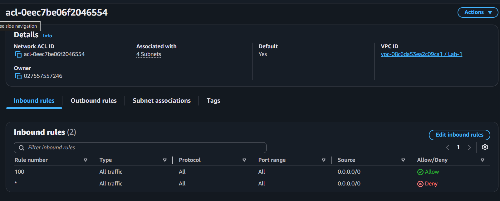

---

## 7. Security Group

```text
Name: Lab-1-instance
```

Inbound:

```text
SSH  TCP 22  0.0.0.0/0
HTTP TCP 80  0.0.0.0/0
```

Outbound:

```text
All traffic → 0.0.0.0/0
```

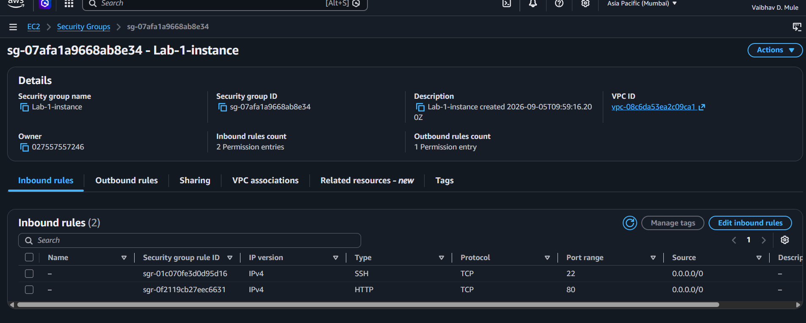

> SSH should ideally be restricted to a known administrative source (`My IP /32`) rather than exposed to the entire Internet — see [Section 16](#16-problems-faced-and-resolution).

---

## 8. EC2 Instances

### Public-A

```text
Name: lab1-public-A
Subnet: Public-Sub-1A-Lab1
Private IP: 10.50.1.165
Public IPv4: 3.109.48.24 (Enabled)
```

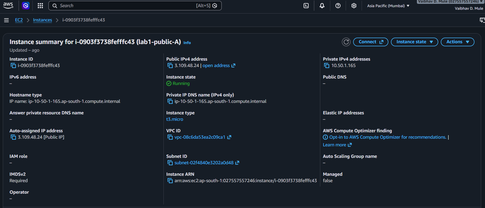

### Public-B

```text
Name: lab1-public-B
Subnet: Public-Sub-1B-Lab1
Private IP: 10.50.2.128
Public IPv4: 13.203.218.179 (Enabled)
```

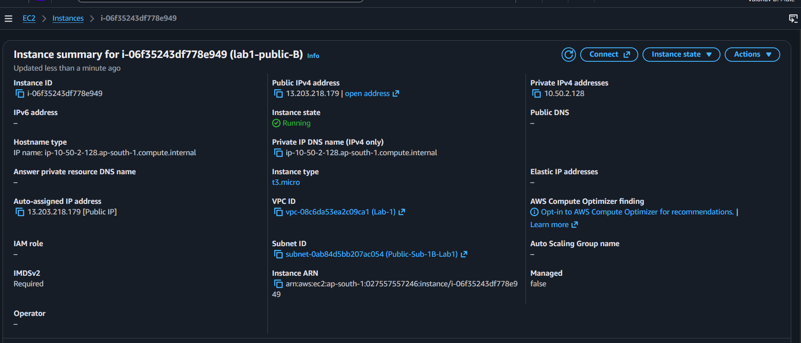

### Private-A / Private-B

```text
Subnet: Private-Sub-2A-Lab1 / Private-Sub-2B-Lab1
Public IPv4: Disabled
```

---

## 9. SSH Access

Connect to a public Amazon Linux instance:

```bash
ssh -i "lab1-key.pem" ec2-user@<PUBLIC-IP>
```

The key pair used is `lab1-key`.

**Never upload `lab1-key.pem` to GitHub.**

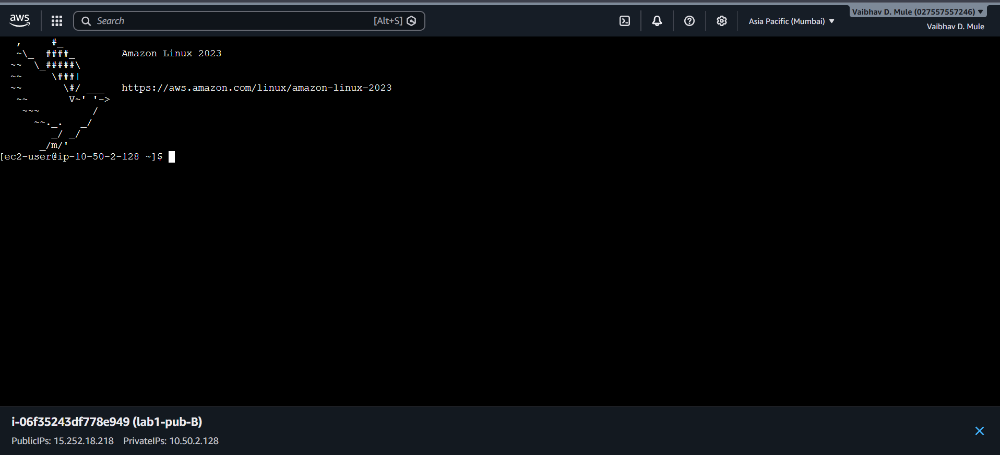

---

## 10. Install Apache

On Amazon Linux 2023:

```bash
sudo dnf install -y httpd
sudo systemctl start httpd
sudo systemctl enable httpd
sudo systemctl status httpd
```

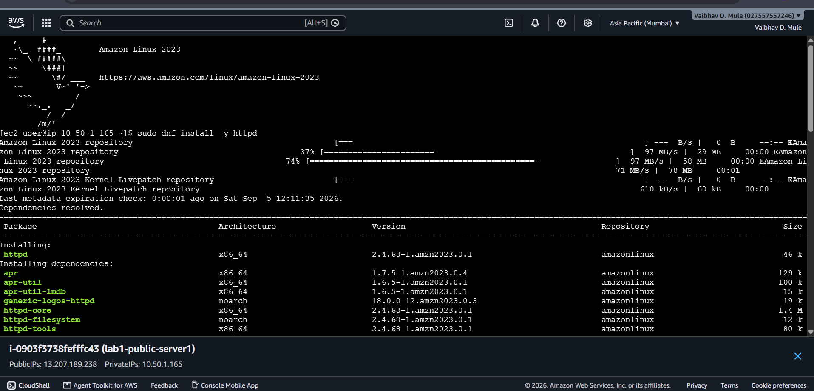

Expected:

```text
Active: active (running)
```

Apache listens on port 80.

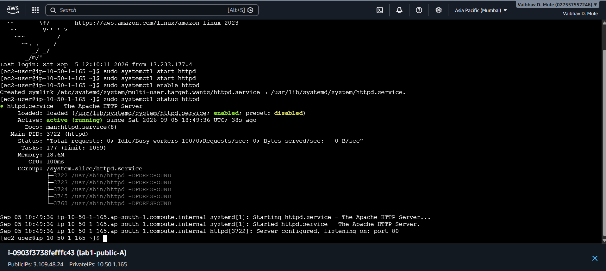

---

## 11. Local HTTP Validation

Run:

```bash
curl http://localhost
```

Expected Apache HTML output:

```text
It works!
```

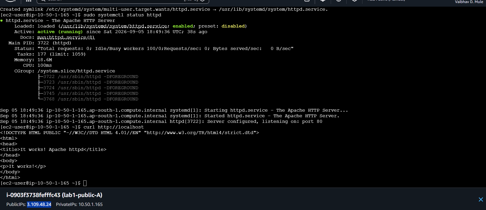

---

## 12. External HTTP Validation

From your local computer open:

```text
http://<PUBLIC-IP>
```

The browser should display:

```text
It works!
```

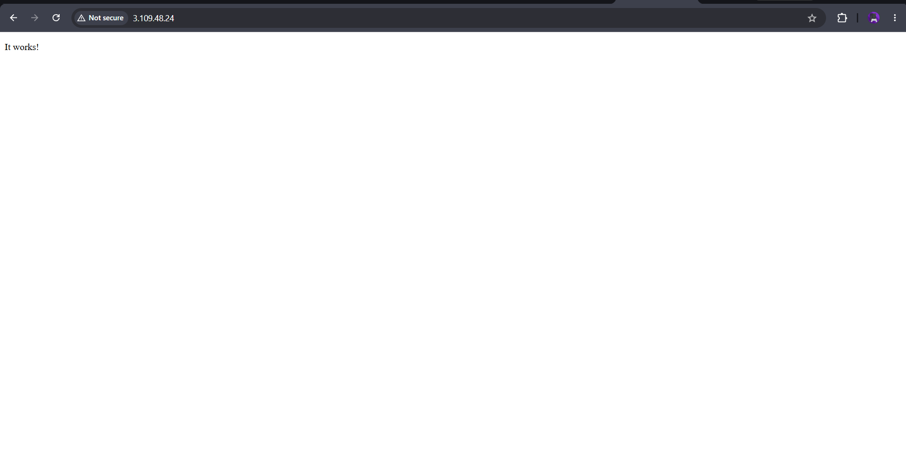

Traffic path:

```text
Internet
  ↓
Internet Gateway
  ↓
Public Route Table
  ↓
Public Subnet
  ↓
EC2 Security Group TCP/80
  ↓
Apache httpd
```

---

## 13. Public vs Private Behavior

### Public

The public subnet has:

```text
0.0.0.0/0 → Internet Gateway
```

and the public EC2 has a public IPv4 address.

### Private

The private route table contains only the local VPC route at this stage:

```text
10.50.0.0/16 → local
```

There is no direct Internet Gateway route. A NAT Gateway would be introduced in a later lab if private instances require outbound Internet access.

---

## 14. Mandatory Failure Injection

Temporarily associate one private subnet with:

```text
Public-Lab1
```

instead of:

```text
private-Lab1
```

Observe the result and explain why changing the route table alone does not give an instance without a public IPv4 address direct Internet connectivity.

After testing, restore:

```text
Private subnet → private-Lab1
```

---

## 15. Validation Checklist

| Test | Expected Result | Status |
|---|---|---|
| VPC CIDR | `10.50.0.0/16` | ✅ |
| Four subnets | 2 public + 2 private | ✅ |
| Two AZs | `ap-south-1a` + `ap-south-1b` | ✅ |
| Internet Gateway | Attached | ✅ |
| Public route | `0.0.0.0/0 → IGW` | ✅ |
| Public subnet associations | Public-A + Public-B | ✅ |
| Private route table | Local route only | ✅ |
| Public EC2-A | Running + public IPv4 | ✅ |
| Public EC2-B | Running + public IPv4 | ✅ |
| Apache | Active/running | ✅ |
| Local HTTP | `curl localhost` works | ✅ |
| External HTTP | Browser reaches Apache | ✅ |
| NACL | Baseline allow rules | ✅ |
| Failure test | Route association tested/restored | ✅ |

---

## 16. Problems Faced and Resolution

### Problem 1 — Public EC2 had no public IPv4

**Symptom:** Public EC2 instances initially showed `Public IPv4: -` even though they were in the intended public subnets.

**Resolution:** Enabled auto-assign public IPv4 on the public subnets and ensured the existing public instances received public IPv4 addresses.

**Lesson:** A public subnet route to an Internet Gateway is necessary, but an IPv4 EC2 instance also needs a public IPv4 address for direct Internet communication.

### Problem 2 — SSH connection failed

**Symptom:** AWS Console displayed `Failed to connect to your instance` / `Error establishing SSH connection`.

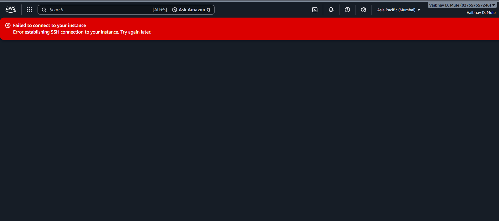

**Investigation:** Checked EC2 running state, public IPv4 address, subnet, route table, Security Group, Network ACL, and key pair.

**Resolution:** Corrected the public networking configuration and successfully established SSH access.

**Lesson:** SSH depends on the complete network path, not only the EC2 instance.

### Problem 3 — Apache external validation

**Resolution:** Verified Apache with `systemctl status httpd` and `curl http://localhost`, then validated the public IP from a browser.

**Result:** Browser returned `It works!`.

**Lesson:** Local service validation and end-to-end network validation are separate tests.

---

## 17. Key Concepts Learned

- **VPC:** Logically isolated virtual network in AWS.
- **Subnet:** IP address range inside a VPC; each subnet belongs to one Availability Zone.
- **Public subnet:** Subnet whose associated route table has a route to an Internet Gateway.
- **Private subnet:** Subnet without a direct route to an Internet Gateway.
- **Route table:** Controls where subnet traffic is sent.
- **Internet Gateway:** Provides Internet connectivity when routing and public addressing are correctly configured.
- **Security Group:** Stateful instance/network-interface firewall.
- **Network ACL:** Stateless subnet-level traffic filter.
- **Public IPv4:** Required for direct Internet communication from an IPv4 EC2 instance.

---

## 18. Repository Structure

```text
LAB-01-Two-AZ-Custom-Enterprise-Network/
├── README.md
└── screenshots/
    ├── 01-vpc.png
    ├── 02-public-subnet-A.png
    ├── 03-public-subnet-B.png
    ├── 04-internet-gateway.png
    ├── 05-public-route-table.png
    ├── 06-private-route-table.png
    ├── 07-network-acl.png
    ├── 08-security-group.png
    ├── 09-public-ec2-A.png
    ├── 10-public-ec2-B.png
    ├── 11-httpd-install.png
    ├── 12-httpd-running.png
    ├── 13-curl-localhost.png
    ├── 14-http-external-validation.png
    ├── 15-public-ec2-B-terminal.png
    └── 16-ssh-connection-failure.png
```

---

## 19. Security Before GitHub Upload

Do **not** upload:

```text
*.pem
*.key
AWS credentials
Access keys
Secret keys
Passwords
Private SSH keys
```

For a public portfolio, consider cropping/redacting AWS account IDs, IAM usernames, and public IP addresses from screenshots before publishing. (Note: the screenshots in this repo currently show the AWS account ID and public IPs — crop/blur these before pushing to a public GitHub repo.)

---

## Lab Status

**LAB-01 — Two-AZ Custom Enterprise Network Foundation**

```text
Status: COMPLETED ✅
```
